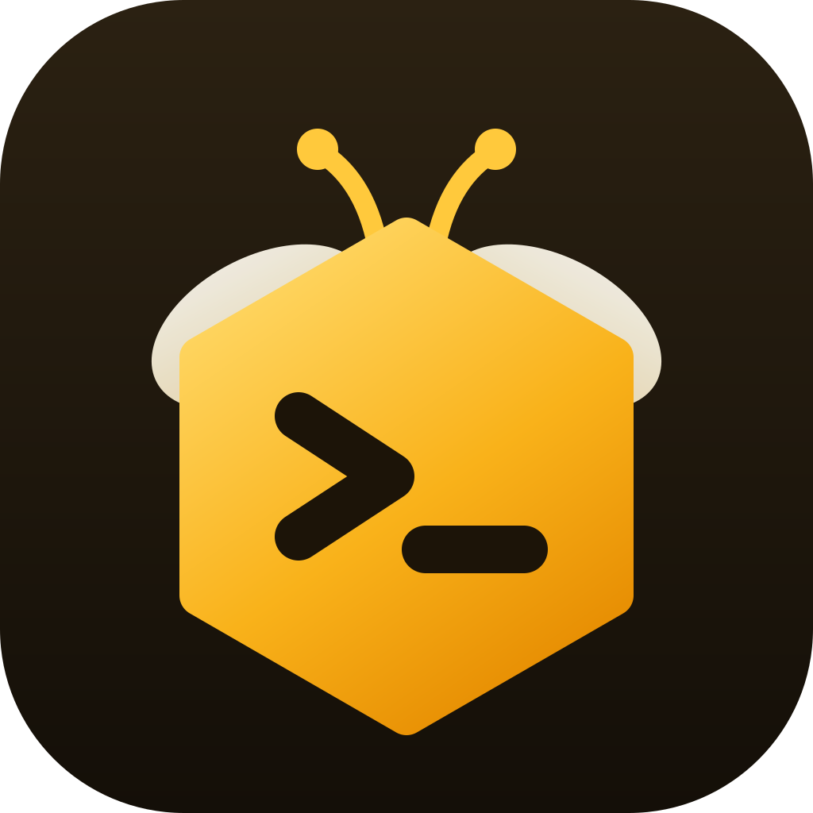

<p align="center">
  
</p>

<h1 align="center">TermBee</h1>
<p align="center"><em>A fast, friendly SSH terminal for Windows and macOS.</em></p>

TermBee keeps every server you work on in one **hive**: saved hosts, tabbed terminals,
logins in your system keychain, and host-key checks that warn you if a server's identity
changes. It's built with [Tauri v2](https://tauri.app) (a Rust core plus a React UI), so the
installer is small and SSH runs natively in Rust.

## Features (v0.1)

- **The Hive**: a home screen with quick connect (`user@host:port`), recent hosts, and all
  hosts grouped by environment, with colors, tags and favorites.
- **Tabbed SSH terminals**: xterm.js with a GPU renderer, a honey color theme, find in
  output, font zoom, copy-on-select, clickable links, and duplicate/reconnect actions.
  Background tabs keep running.
- **Dual-pane SFTP**: This PC on the left, the server on the right. Drag files or whole
  folders between them (or press F5, or copy in one and paste in the other), drag onto a
  folder to move, sort any column, filter, show hidden files, or switch to an icon grid.
  Preview images and text, and edit text files on the server in place. The transfer queue
  shows speed and time left, and can retry, cancel, or open what you downloaded. Any SSH host
  switches between its terminal and its files in one click.
- **Folders**: nest hosts in folders (`Production/EU`), drag hosts and folders to move or
  reorder them, and rename or delete folders (their hosts move up, never get deleted).
- **Icons**: SSH, SFTP and RDP each have their own badge, and every host can show one of 27
  icons instead of its initials.
- **Remote Desktop (RDP) hosts** live in the same hive and open in the system's own client:
  Remote Desktop Connection (`mstsc`) on Windows, with a saved password filled in, and
  Microsoft's free [Windows App](https://apps.apple.com/app/windows-app/id1295203466) on
  macOS, which asks for the password itself and can keep it in your Keychain.
- **Logins in the keychain only**: passwords and key passphrases go to Windows Credential
  Manager or the macOS Keychain. They are never written to TermBee's files or sent to the
  UI. You can be asked at connect time and choose "remember".
- **Key or password login**, with keyboard-interactive fallback. `~/.ssh` keys are suggested.
- **Host-key trust on first use**: you confirm a server's fingerprint the first time you
  connect, and get a red warning if it later changes. Hosts you already trust in OpenSSH's
  `~/.ssh/known_hosts` are accepted silently.
- **Command palette**: ⌘K on macOS, Ctrl+Shift+P on Windows. Find hosts, switch tabs,
  quick connect, or run any action.
- **Hive (dark) and Meadow (light) themes**, plus following the system setting.
- **Smooth on any PC**: motion that uses only GPU-friendly properties, and a "Motion & effects"
  setting whose Auto mode turns off animation and blur on slower machines.

## Develop

Prerequisites: Node 24+, Rust stable (1.85+), and the platform's
[Tauri prerequisites](https://tauri.app/start/prerequisites/): WebView2 + MSVC build tools on
Windows, Xcode command-line tools on macOS.

```bash
npm install
npm run dev          # the desktop app with hot reload
npm run dev:web      # the UI alone in a browser, backed by a mock (no SSH) — handy for design work
```

Checks:

```bash
npm run typecheck && npm run lint
npm run check:rust
cargo test --manifest-path src-tauri/Cargo.toml
```

Live SSH test against a real server (it is skipped unless these variables are set):

```bash
TERMBEE_TEST_HOST=127.0.0.1 TERMBEE_TEST_PORT=2222 TERMBEE_TEST_USER=bee TERMBEE_TEST_PASSWORD=secret \
  cargo test --manifest-path src-tauri/Cargo.toml --test ssh_live -- --nocapture
```

## Build installers

```bash
npm run build        # Windows → src-tauri/target/release/bundle/nsis/TermBee_<ver>_x64-setup.exe
                     # macOS   → …/bundle/dmg/TermBee_<ver>_<arch>.dmg (build on a Mac)
```

You can't build for macOS from Windows. Installers are built locally, not on GitHub
Actions (the `checks` workflow only runs when started by hand, so it uses no minutes).

## Release

Releases are built on your own machines and uploaded to
[GitHub Releases](https://github.com/shaik-noor/TermBee/releases), where users download
them. You need the [GitHub CLI](https://cli.github.com), logged in once with `gh auth login`.

1. Set the new version in **both** `package.json` and `src-tauri/Cargo.toml`, then commit
   and push it to `main`.
2. On Windows, run the release. It checks the code, builds `TermBee_<ver>_x64-setup.exe`,
   creates the release `v<ver>` with notes, and uploads the installer:

   ```bash
   npm run release
   ```

3. On a Mac, pull the same commit and run the same command. It builds
   `TermBee_<ver>_universal.dmg` (Apple Silicon + Intel) and adds it to the same release.

Options: `-- --dry-run` builds without uploading, `-- --draft` creates the release as a
draft so you can publish it once both installers are attached, and `-- --skip-checks`
skips typecheck/lint/clippy/tests.

The builds aren't code-signed yet. Windows SmartScreen asks users to click **More info →
Run anyway**. The Mac app is ad-hoc signed, so macOS asks users to approve it once in
**System Settings → Privacy & Security → Open Anyway**. The release notes explain both. To
remove those prompts later, Windows needs an Authenticode certificate, and macOS needs a
Developer ID plus notarization. Auto-update needs `tauri-plugin-updater` and a signing key
pair.

Regenerate the app icons after changing the logo with `npm run icons`.

## Where things live

| What                               | Where                                      |
| ---------------------------------- | ------------------------------------------ |
| Saved hosts (no secrets)           | `<app data>/hosts.json`                    |
| Empty host folders                 | `<app data>/folders.json`                  |
| Trusted host keys                  | `<app data>/known_hosts.json`              |
| Passwords / passphrases            | OS keychain, service `app.termbee.desktop` |
| UI preferences                     | WebView localStorage (`termbee:prefs`)     |
| RDP launch files (no secrets)      | `<temp>/termbee-rdp/<host id>.rdp`         |
| RDP password for `mstsc` (Windows) | Credential Manager, `TERMSRV/<host>`       |

`<app data>` is `%APPDATA%\app.termbee.desktop` on Windows and
`~/Library/Application Support/app.termbee.desktop` on macOS.

See [docs/ARCHITECTURE.md](docs/ARCHITECTURE.md) for how the pieces fit together.

## Contributing

Contributions are welcome! See [CONTRIBUTING.md](CONTRIBUTING.md) for how to set up, the
checks to run, and the house rules.

## License

[MIT](LICENSE) © Shaik Noor
